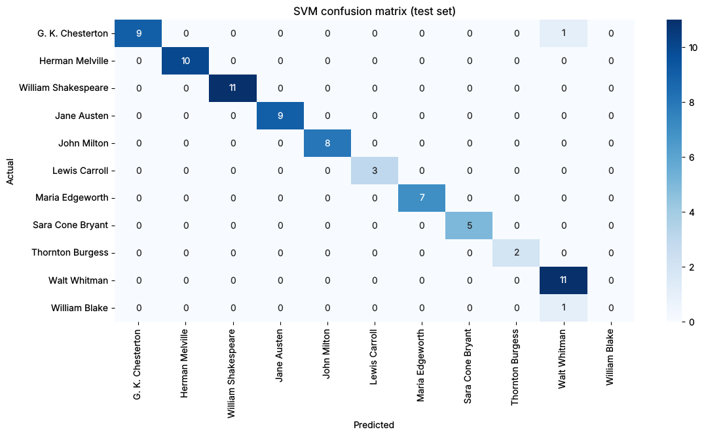
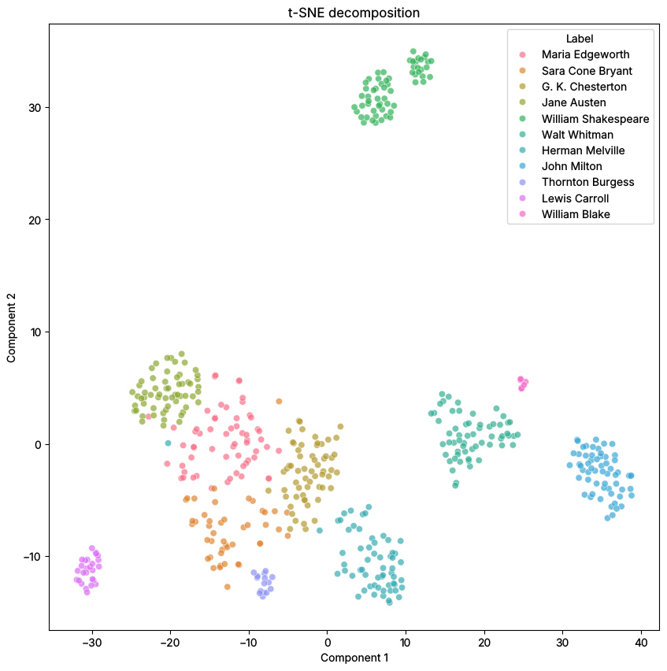

# Who wrote this? Author attribution with TF-IDF and classical classifiers

Given a passage of text, predict its author. This project turns labeled documents (CSV rows or
folders of `.txt`/`.docx`/`.pdf` files) into TF-IDF features, tunes six scikit-learn classifiers
on the same split and compares them side by side, with confusion matrices, PCA/t-SNE maps and
chi-squared keyword lists for each label.

## Results

### Eleven classic authors, 1,000-word passages (reproducible quick start)

512 passages from the Project Gutenberg selection that ships with NLTK (Austen, Blake, Bryant,
Burgess, Carroll, Chesterton, Edgeworth, Melville, Milton, Shakespeare, Whitman), up to 60 per
author. 435 passages for training, 77 for testing.

| Model | 5-fold CV accuracy (train) | Train accuracy | Test accuracy |
| --- | ---: | ---: | ---: |
| **SVM (polynomial kernel, degree 4, C = 0.1)** | **0.970** | 0.998 | 0.974 |
| Multinomial logistic regression (C = 0.87, balanced) | 0.968 | 0.986 | 0.961 |
| k-nearest neighbors (k = 1) | 0.956 | 1.000 | 0.987 |
| Random forest (800 trees, depth 80) | 0.956 | 1.000 | 0.935 |
| Multinomial Naive Bayes | 0.913 | 0.929 | 0.922 |

The best model is chosen by cross-validated accuracy on the training set alone, which makes
the SVM the pick; test accuracy is only reported (see [Approach](#approach), step 6). The SVM
gets 75 of 77 test passages right, missing a William Blake poem and a G. K. Chesterton passage,
both assigned to Walt Whitman. k-nearest neighbors happens to score higher on this test split
(76 of 77; its one miss is a Maria Edgeworth passage assigned to Chesterton), but with 77 test
passages that gap is a single passage, and KNN ranks below the SVM and logistic regression in
cross-validation. The rows above are `docs/model_comparison_gutenberg_passages.csv`. The t-SNE
map shows why the task is this separable: Shakespeare, Milton, Whitman (with Blake beside him), Melville and Carroll form
their own islands, while the remaining prose writers overlap, with the children's storytellers
Edgeworth, Bryant and Burgess next to Austen and Chesterton.

<p align="center">
  <br>
  
</p>

Passages from the same book can land on both sides of the split, so the models can lean on
recurring names and settings as well as style.

### 45 authors, Project Gutenberg short stories (original 2020 run)

The first version of this project classified 988 short stories by author. Keeping authors with
at least four stories left 374 stories by 45 authors (317 train, 57 test). The largest label is
the anthology credit "Various" with 69 stories, so always guessing it scores about 18%.

| Model | Train accuracy | Test accuracy |
| --- | ---: | ---: |
| SVM (polynomial kernel, degree 4, C = 0.1) | 0.997 | **0.754** |
| Random forest (800 trees, depth 80) | 1.000 | 0.667 |
| k-nearest neighbors (k = 1) | 1.000 | 0.579 |
| Multinomial logistic regression (`sag` solver) | 0.587 | 0.368 |
| Multinomial Naive Bayes | 0.202 | 0.175 |

With 45 labels and only a handful of stories for most of them, the SVM still names the right
author for three of every four held-out stories. Naive Bayes on 300 sublinear TF-IDF features
does no better than the majority guess. That run used scikit-learn 0.22, and its logistic
regression used the `sag` solver, which had not converged; the current code uses `lbfgs`.
That run recorded no cross-validation scores, so the bold marks the highest test accuracy, not a
model picked by the selection rule below. The short-story CSV is not part of this repository
(see [Data](#data)).

## Approach

1. **Load** a corpus: a CSV with text/label/title columns, or a folder tree where each
   sub-folder name is the label (`textclf/documents.py`).
2. **Filter** labels with `--threshold` (default 3) or fewer examples.
3. **Split** 85/15 with a fixed seed (8).
4. **Vectorize** with TF-IDF: unigrams and bigrams, case kept, `min_df = threshold`, top 300
   terms, sublinear term frequency, L2 norm. `--clean-texts` lowercases, strips punctuation,
   lemmatizes and drops stopwords first; the results above use the raw text.
5. **Tune and fit** each model (`textclf/classifier.py`):
   - random forest and gradient boosting: 50-draw randomized search, then a grid search at the best point
   - SVM: grid over linear, polynomial and RBF kernels and C
   - KNN: grid over k = 1…200
   - logistic regression: grid over C with balanced class weights
   - Naive Bayes: defaults
6. **Select** the best model as the one with the highest mean accuracy over the same seeded
   stratified 5-fold split of the training set, with ties going to the simpler model
   (`textclf/selection.py`). Training and test accuracy are reported next to it, but the test
   set is never used to choose.
7. **Inspect** with confusion matrices, PCA and t-SNE plots, misclassified test rows
   (`mod_test`) and the most label-correlated terms (`cor_unigrams_and_bigrams`).

## Quick start

```bash
python -m venv .venv && source .venv/bin/activate
pip install -r requirements.txt

python scripts/prepare_gutenberg.py                          # writes data/gutenberg_passages.csv
python classify.py --data data/gutenberg_passages.csv --plots
python -m pytest                                             # smoke and unit tests on synthetic data, ~2 s
```

The classifier run takes about five minutes on four CPU cores, most of it in the random-forest
search. It prints each model's tuned hyperparameters, CV accuracy and classification report,
then the selected model, and writes to `outputs/`:

- `model_comparison_<name>.csv` (CV, training and test accuracy per model)
- `<model>_heatmap_<name>.png` (with `--plots`)
- `dimension_reduction_{PCA,TSNE}_<name>.png` (with `--plots`)
- `<name>.p` (pickled classifier; reload with `--resume`)
- `run.log`

Useful options:

```bash
python classify.py --models SVM KNN                 # fit only these
python classify.py --models best                    # all six, including gradient boosting (slow)
python classify.py --data path/to/folders           # one sub-folder per author
python classify.py --data my.csv --text-column body --label-column writer --title-column name
```

From Python:

```python
from textclf import TextClassifier, corpify

corpus = corpify("data/gutenberg_passages.csv", "content", "Author", "Title")
clf = TextClassifier(corpus, model=["SVM", "KNN"], project="passages")
clf.mod_predict("Call me Ishmael. Some years ago, never mind how long precisely...")
clf.cor_unigrams_and_bigrams()
```

## Data

- **Gutenberg passages.** `scripts/prepare_gutenberg.py` downloads NLTK's `gutenberg` corpus
  (18 public-domain Project Gutenberg texts) and cuts each book into consecutive 1,000-word
  passages, taking up to 60 per author evenly across their books. The King James Bible is left
  out because it has no single author, and each file's `[Title by Author Year]` header line is
  dropped so the label never appears in the text. `--words` and `--max-per-author` change the
  passage size and the cap.
- **Short stories.** The 2020 run read `data/story.data.csv`, with one Project Gutenberg short
  story per row in the columns `content`, `Author` and `Title`. That file is not redistributed
  here. Any CSV with the same columns runs as is:
  `python classify.py --data data/story.data.csv`.

## Repository layout

```
classify.py                  command-line entry point
scripts/prepare_gutenberg.py builds the quick-start dataset
textclf/
  config.py                  repo-relative data/ and outputs/ paths
  documents.py               Document and Corpus, DOCX/PDF/TXT/CSV loading
  preprocessing.py           cleaning, lemmatization, stopwords
  classifier.py              TF-IDF, model search, comparison and plots
  selection.py               the best-model rule (CV accuracy, ties to the simpler model)
tests/test_smoke.py          end-to-end run on a synthetic corpus
tests/test_selection.py      unit tests for the selection rule
docs/                        figures and the model comparison used in this README
```
